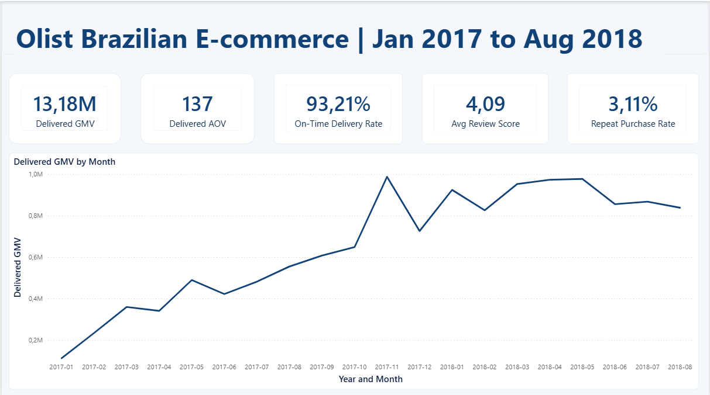
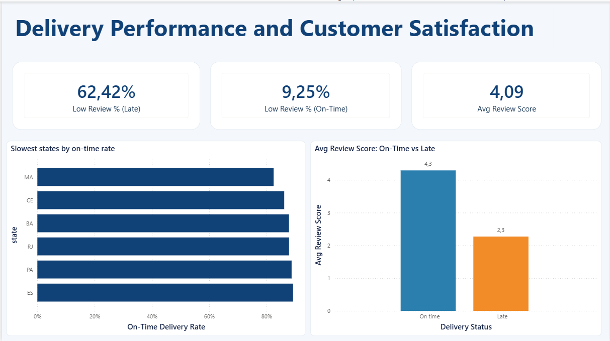
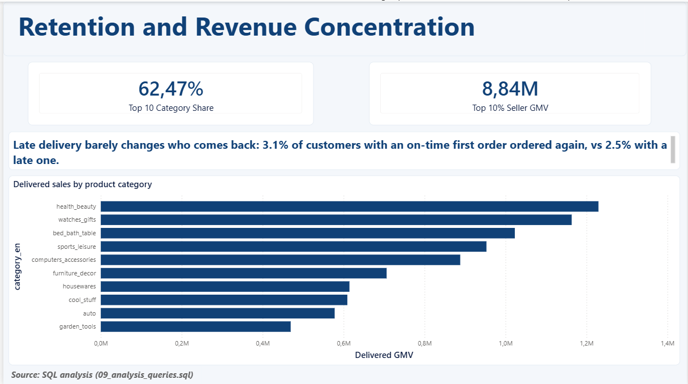

# Olist E-commerce Dashboard (Power BI)

A three-page Power BI dashboard built on the Olist Brazilian e-commerce dataset. It answers one business question:

> **Olist grew quickly, but very few customers came back. Is delivery the reason?**

This is the Power BI half of a SQL-to-Power BI ETL project. The SQL half (loading, cleaning and building the star schema) lives in [`/sql`](./sql).



## The short answer

- **Late deliveries are rare, but they hurt.** About 7% of delivered orders arrive late. Those customers rate Olist roughly 2 stars lower (about 4.3 on time vs 2.3 late), and about 6 in 10 leave a 1-2 star review.
- **Delivery is not the main reason customers don't return.** Only about 3% of customers ever order a second time, and that is true even when their first delivery was on time.
- **Sales are concentrated.** The top 10 product categories bring in about 62% of sales, and the top 10% of sellers about 67%.

**So what?** Growth depends on constantly finding new customers. Fixing delivery would protect reviews, but it won't fix repeat buying on its own.

**Now what?** Test retention ideas beyond delivery (for example, post-purchase re-engagement), and aim delivery fixes at the slowest states, starting with MA.

## The dashboard

| Page | Question it answers | What's on it |
|---|---|---|
| **1. Overview** | How big is the business, and how did it grow? | 5 KPI cards, monthly sales trend |
| **2. Delivery and satisfaction** | Where are orders late, and what does lateness do to reviews? | On-time rate by state, review score on time vs late, low-review share |
| **3. Retention and concentration** | Do customers come back, and who earns the money? | Repeat rate, top-category and top-seller share, sales by category |




## North-star metric and KPIs

The north-star metric is **Delivered GMV**: the total item value of orders that were delivered, in Brazilian reais. It is a stand-in for revenue (Olist's real revenue is commission, which isn't in the data).

| KPI | What it tells you | Latest value |
|---|---|---|
| Delivered GMV and AOV | Size of the business and average order value | about R13.2M and R137 |
| On-time delivery rate | % of orders delivered on or before the estimated date | 93.2% |
| Average review score | Customer satisfaction (1 to 5) | 4.09 |
| Repeat purchase rate | % of customers who ordered more than once | 3.1% |
| Revenue concentration | Share of sales from the top 10 categories / top 10% of sellers | 62% / 67% |

## Data model

A star schema with two fact tables, because the KPIs live at two levels: delivery and reviews are per **order**, while sales value is per **item**. Keeping them separate stops orders with several items from being counted several times.

| Table | One row per |
|---|---|
| `fact_orders` | Order |
| `fact_order_items` | Item in an order |
| `dim_date` | Calendar day |
| `dim_customer` | Customer ID (the real person is `customer_unique_id`) |
| `dim_product` | Product (English category) |
| `dim_seller` | Seller |
| `dim_payment_type` | Payment method |

**Relationships:** nine in total, all one-to-many, filtering from dimension to fact. `fact_orders` has three date relationships (purchase is active; delivered and estimated are inactive and available through `USERELATIONSHIP`). The two fact tables are deliberately **not** linked to each other, which avoids double counting.

## How it was built

1. **SQL:** raw CSVs loaded into a `stg` schema, then cleaned into a star schema in a `dw` schema.
2. **Power BI:** connected in Import mode to the `dw` tables only.
3. **Model:** relationships set up as above.
4. **Measures:** all DAX measures live in one `_Measures` table.
5. **Checks:** every measure was matched against an equivalent SQL query on the warehouse before it went on a page.

## Selected DAX

Power BI shows the tables with their schema prefix, for example `'dw fact_orders'`.

**Delivered GMV** (the north star)

```dax
Delivered GMV =
CALCULATE(
    SUM('dw fact_order_items'[price]),
    'dw fact_order_items'[order_status] = "delivered"
)
```

**On-time delivery rate** (built from two simple parts)

```dax
On-Time Orders =
COUNTROWS(
    FILTER(
        'dw fact_orders',
        NOT ISBLANK('dw fact_orders'[is_late]) && 'dw fact_orders'[is_late] = FALSE()
    )
)

Orders With Delivery Date = COUNTA('dw fact_orders'[is_late])

On-Time Delivery Rate = DIVIDE( [On-Time Orders], [Orders With Delivery Date] )
```

`NOT ISBLANK` matters: undelivered orders have a blank `is_late`, and without it they would quietly count as "on time".

**Revenue concentration**

```dax
Top 10 Category GMV =
CALCULATE(
    [Delivered GMV],
    TOPN( 10, ALL('dw dim_product'[category_en]), [Delivered GMV] )
)

Top 10 Category Share = DIVIDE( [Top 10 Category GMV], [Delivered GMV] )
```

## Data-quality decisions

- **Analysis window: Jan 2017 to Aug 2018.** Earlier and later months have too few orders and would distort growth.
- **Real customers are counted by `customer_unique_id`.** `customer_id` changes with every order.
- **Only delivered orders count towards GMV.**
- **`is_late` is left blank, not 0, for undelivered orders,** so they don't inflate the on-time rate.
- **One review per order** (the latest), and payments are summed per order, so no order is counted twice.
- **Missing product categories are labelled `Unknown`** and kept, so sales aren't understated.

## Limitations

- GMV is a proxy for revenue, not Olist's actual income.
- The data covers about 20 months, so "repeat" customers who returned later aren't captured.
- Late delivery is **linked** to lower reviews and slightly lower repeat buying. That does not prove it is the only cause (late orders may also be the far-away ones or come from certain sellers).
- The repeat rate split by first-delivery status comes from a SQL query (`sql/09_analysis_queries.sql`) and is shown as a text note on page 3, not as a live measure.

## Repository layout

```
olist-project/
  sql/          numbered SQL scripts (setup, profiling, star schema, analysis)
  powerbi/      Olist_Dashboard.pbix
  docs/         SOP documents
  images/       dashboard screenshots
```

## Data source

[Brazilian E-Commerce Public Dataset by Olist](https://www.kaggle.com/datasets/olistbr/brazilian-ecommerce) (Kaggle).

## Tools

SQL Server (SSMS) and Power BI (DAX).

## Author

Sibongile Seale
